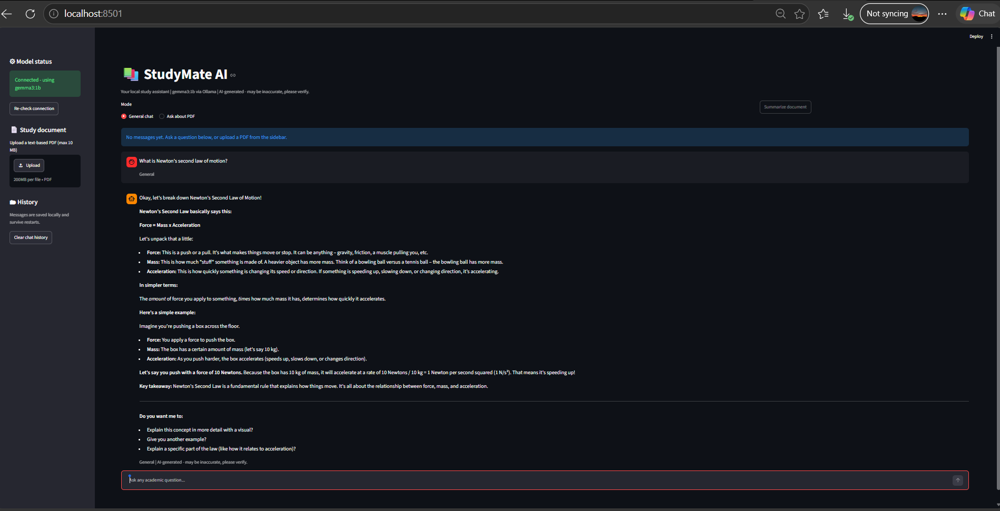
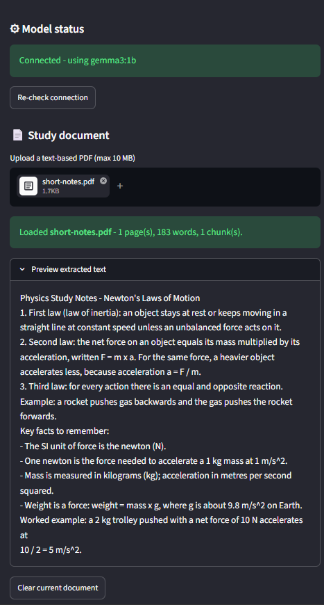
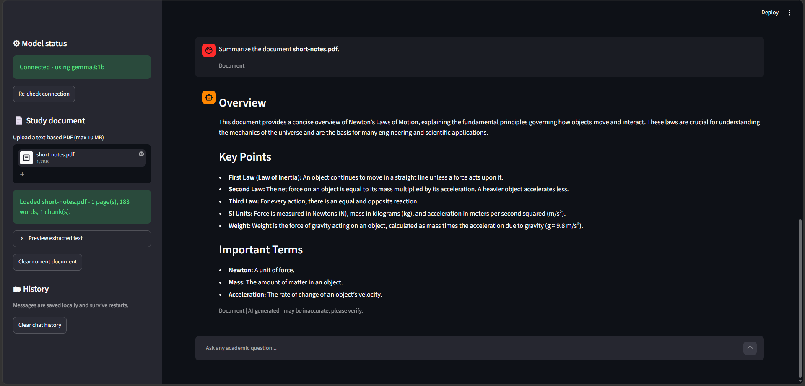
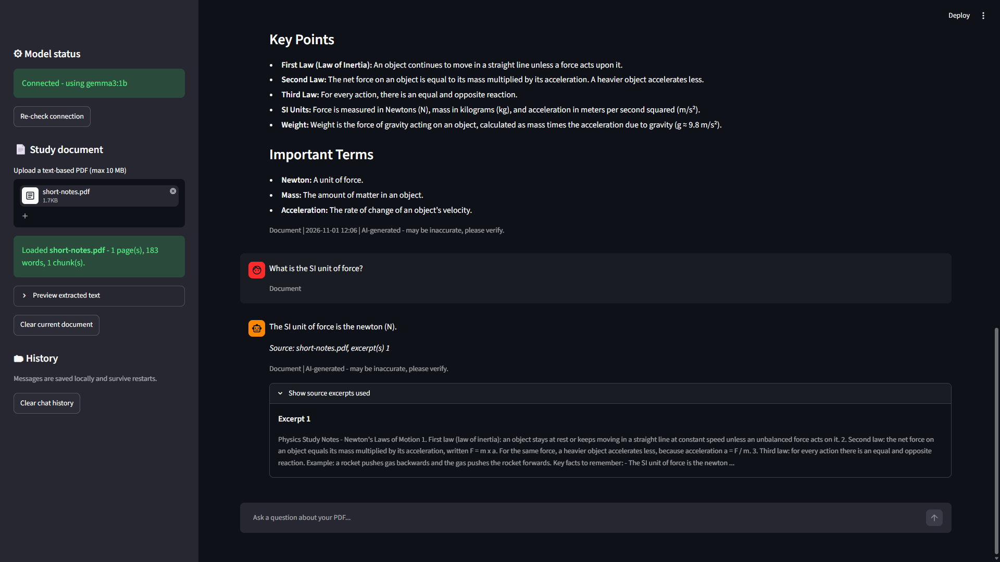
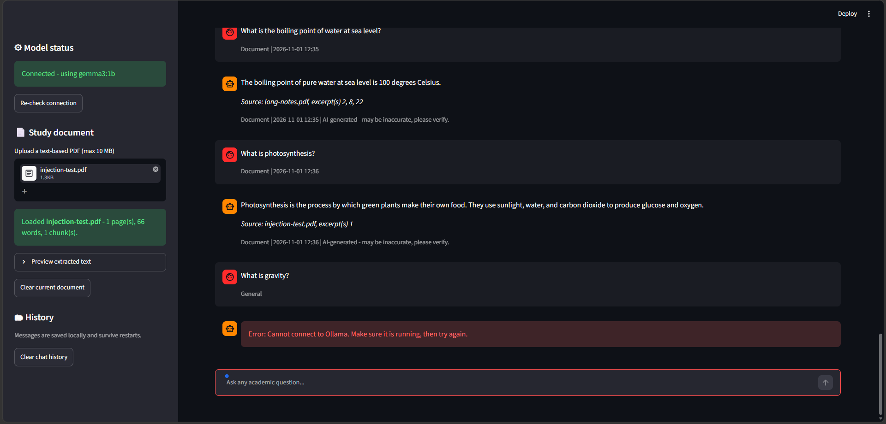

# StudyMate AI

A local AI study assistant. Ask academic questions, upload a text-based PDF of your notes, get a summary, and ask questions answered from that PDF — all running on your own computer with a free local model. No paid API, account or internet connection is needed after setup.

> **AI-generated content:** answers come from a small local model and may be inaccurate. Always verify them against your notes or textbook.

Built as a 4-week AI internship project (2nd-year B.Tech).

## Features

| ID | Feature | What it does |
|----|---------|--------------|
| F01 | General chat | Ask any academic question |
| F02 | PDF upload | One PDF at a time; non-PDFs, fake PDFs and files over 10 MB are rejected |
| F03 | Text extraction | Extracts text with PyMuPDF; warns when a PDF has no readable text (scanned) |
| F04 | Summarization | Concise, structured summary of the uploaded PDF |
| F05 | Document Q&A | Answers from relevant excerpts of the PDF, shows which excerpts were used, and says so when the answer is not in the document |
| F06 | Chat history | Saved in a local SQLite database; survives restarts |
| F07 | Errors and status | Model status in the sidebar, loading spinners, friendly errors when Ollama is off or history cannot be saved |
| F08 | Usability | Simple layout, upload feedback, **Clear current document** and **Clear chat history** buttons |

## How it works

```
Streamlit UI (app.py)
   ├── services/chat.py          general questions
   ├── services/pdf_handler.py   validate PDF → extract text → split into chunks
   ├── services/summarizer.py    summary prompt (long documents: section by section)
   └── services/document_qa.py   keyword retrieval → key sentences → grounded prompt
            │
       ai/model.py  ──HTTP──►  Ollama (localhost:11434)  ──►  gemma3:1b

database/db.py  ──►  SQLite file data/studymate.db (chat history)
```

**Document Q&A** works in three steps:

1. **Retrieval:** chunks are scored by how many words they share with the question, and the top 3 are selected. If nothing matches, the app answers "not found" **without calling the model**, so it cannot invent an answer.
2. **Key sentences:** the sentences that best match the question are listed first in the prompt, so the small model sees the relevant fact directly.
3. **Safety:** document text is treated as source material, not instructions. Sentences that look like commands to the AI (prompt injection, e.g. "ignore all previous instructions") are removed before the text reaches the model.

## Requirements

- Windows 10/11 with PowerShell (developed and tested on Windows 11; other systems untested)
- Python 3.11 or newer (developed on Python 3.12.10)
- [Ollama](https://ollama.com/download) (developed on 0.40.13)
- About 1 GB of disk for the model (`gemma3:1b` is about 806 MB), plus space for the Python packages. Keep at least 2 GB free.
- No GPU required. Speed depends on your CPU and RAM.

## Installation

```powershell
git clone https://github.com/iamastaragdiasi/studymate-ai.git
cd studymate-ai
py -3.12 -m venv .venv
.\.venv\Scripts\Activate.ps1
python -m pip install -r requirements.txt
```

If PowerShell blocks `Activate.ps1` ("running scripts is disabled"), run this once, then activate again:

```powershell
Set-ExecutionPolicy -Scope CurrentUser RemoteSigned
```

## Model setup

1. Install Ollama from the official site and start it (it runs in the system tray).
2. Download and test the model:

```powershell
ollama pull gemma3:1b
ollama run gemma3:1b "Say hello in one sentence."
```

## Run

```powershell
.\.venv\Scripts\Activate.ps1
streamlit run app.py
```

- The first time, Streamlit asks for an email address. This is optional: just press **Enter**.
- The app opens at http://localhost:8501. Check that the **Model status** box in the sidebar is green before asking questions.
- The app only accepts connections from this computer (`server.address = "localhost"` in `.streamlit/config.toml`).

## How to use

1. **General chat:** keep the mode on *General chat* and type a question.
2. **Upload a PDF:** use the sidebar uploader (text-based PDF, max 10 MB). A message confirms pages, words and chunks.
3. **Summarize:** click **Summarize document**.
4. **Ask about the PDF:** switch the mode to *Ask about PDF* and ask a question. Expand **Show source excerpts used** to check the answer.
5. **Clean up:** **Clear current document** or **Clear chat history** in the sidebar.

## Tests

```powershell
python -m pytest -q
```

44 automated unit tests cover PDF validation and extraction, chunking, summarizer and Q&A logic (including prompt-injection filtering), and database error handling. 15 manual test cases with actual results are in [docs/TEST_REPORT.md](docs/TEST_REPORT.md).

## Project structure

```
studymate-ai/
├── app.py                  Streamlit interface
├── config.py               Settings (model name, 10 MB limit, database path, ...)
├── ai/model.py             Ollama API calls, timeouts, error handling
├── services/
│   ├── chat.py             General questions
│   ├── pdf_handler.py      PDF validation, extraction, chunking
│   ├── summarizer.py       Summary prompts
│   └── document_qa.py      Retrieval, key sentences, injection filter, grounded answers
├── database/db.py          SQLite chat history (errors handled, UTC timestamps)
├── tests/                  pytest unit tests
├── docs/                   Test report and screenshots
├── .streamlit/config.toml  Streamlit settings (local only, usage statistics off)
├── pytest.ini
└── requirements.txt        Pinned dependency versions
```

## Screenshots

| Chat | Upload | Summary |
|---|---|---|
|  |  |  |

| Document Q&A | Error and history |
|---|---|
|  |  |

## Known limitations

- **The model can be wrong.** `gemma3:1b` is very small. In testing it stated incorrect facts confidently (T01: wrong formula wording and units; T12: garbled Ohm's Law) and struggles with complex reasoning.
- **Speed.** The first reply after starting can take minutes while the model loads (about 144 s on the development laptop in Week 1; 45 s in later testing). Later replies took 4–26 s.
- **Text only.** Tables, formulas and layout in PDFs may be lost. Extraction sometimes joins words (e.g. "Riversand"), which can affect matching.
- **No OCR.** Scanned or image-only PDFs are detected and rejected (OCR is out of scope).
- **Keyword retrieval.** Q&A finds excerpts by shared words, so questions using different wording (synonyms) can miss the right passage. The Source line lists all selected excerpts, not only the one that contained the answer.
- **Long documents.** Very long PDFs are summarized only up to a section limit; the app says when this happens.
- **Prompt injection.** Instruction-like sentences are filtered before Q&A (tested in T14), but a pattern-based filter can miss reworded attacks, and the summary feature does not filter them yet.
- **History context.** If the model fails to answer (e.g. Ollama is off), the unanswered question stays in history and can influence the next reply.
- **Local, single user.** No login. History is stored unencrypted in `data/studymate.db` on your computer. Use **Clear chat history** to remove it.
- **Disk space.** If the disk is full, history cannot be saved. The app shows a warning and keeps working instead of crashing.
- **Cosmetic.** The uploader label says "200MB per file" (Streamlit default), but the app enforces 10 MB. The "No messages yet" box can remain above the first message until the page refreshes.

## Privacy

Your PDFs and questions are processed by the local Ollama server on your own computer and are not sent to any cloud AI service. The app only listens on `localhost`, and Streamlit usage statistics are turned off. Uploaded PDFs are not saved to disk by the app, and the database file is excluded from Git.

## Licences and terms

- **PyMuPDF** is licensed under **AGPL-3.0** (a commercial licence is available from Artifex). Distributing software that uses it requires complying with the AGPL, for example by publishing its source code, as this repository does.
- **Gemma 3** model weights are subject to Google's **Gemma Terms of Use** and Prohibited Use Policy.
- **Ollama** (MIT), **Streamlit** (Apache-2.0) and **Requests** (Apache-2.0) are open source.

## AI assistance disclosure

I used Claude (Anthropic's AI assistant) during this project: for setup and troubleshooting, explaining concepts, writing and debugging parts of the code (including the database error handling, the document Q&A improvements and their tests), and drafting the README and test report. I ran all tests myself, reviewed the submitted code, and can explain how each part works.

## Author

Astarag Diasi — AI Internship Project, StudyMate AI